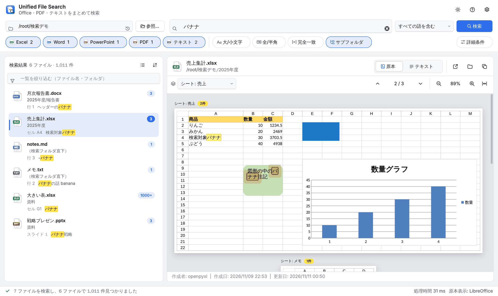
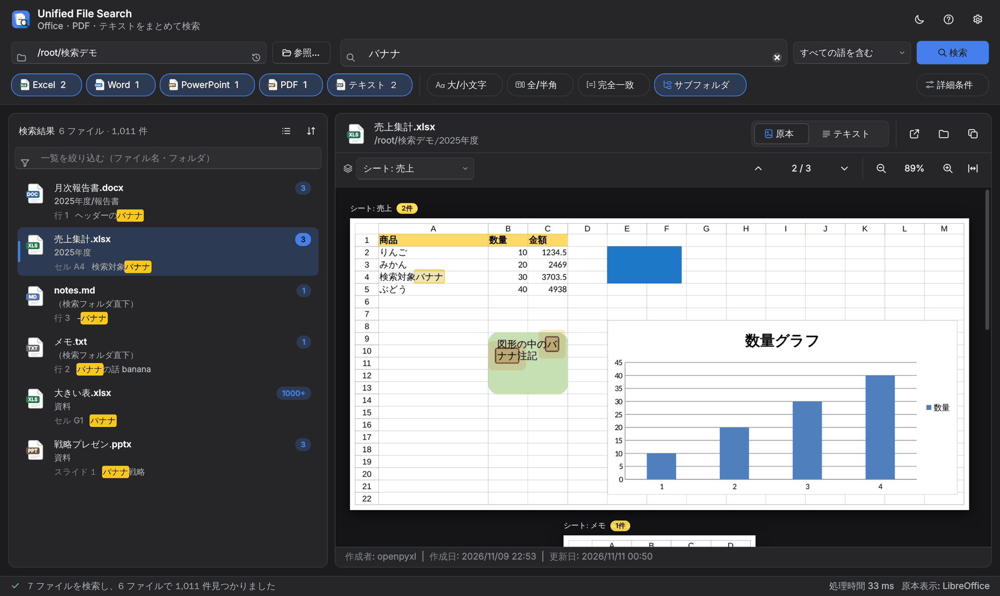

# Unified File Search Tool


フォルダ配下の Office 文書・PDF・テキストを、**ファイルを1つずつ開かずに横断検索**し、
ヒットした箇所を **「そのファイルを直接開いたのと同じ見た目」** のプレビュー上で確認できる Windows 向けデスクトップアプリです。

- Excel は枠線・行列番号つきのシートとして表示され、**図形・テキストボックス・グラフ・画像もそのまま**見えます
- Word / PowerPoint / PDF もページ・スライドのレイアウトのまま表示されます
- 検索語に一致した箇所は **蛍光ペン風にマーキング**され、`F3` で順に移動できます
- Windows 11 に合わせたモダンなデザイン。ライト / ダーク、Windows のアクセント カラーに追従します



<details>
<summary>ダーク テーマ</summary>



</details>

## 対応形式

| 種類 | 拡張子 | プレビュー |
| --- | --- | --- |
| Excel | `.xlsx` `.xlsm` | 原本表示（シート + 図形・グラフ・画像） / テキスト表示 |
| Word | `.docx` | 原本表示（ページ） / テキスト表示 |
| PowerPoint | `.pptx` | 原本表示（スライド） / テキスト表示 |
| PDF | `.pdf` | 原本表示（ページ） / テキスト表示 |
| テキスト | `.txt` `.md` `.log` | 行番号つきテキスト表示（文字コード自動判別） |

## 必要要件

- Python 3.11 以上
- [uv](https://github.com/astral-sh/uv)（パッケージマネージャ）
- **Office ファイルを原本表示するための変換エンジン（どちらか一方）**
  - Microsoft Office（Windows。インストール済みなら自動で使われます）
  - [LibreOffice](https://ja.libreoffice.org/)（Windows / macOS / Linux。無料）

変換エンジンが無い場合もアプリは動作し、Office ファイルは「テキスト表示」（表やシートを再構成した表示）になります。
PDF は変換エンジンなしで原本表示できます。
起動時、どのエンジンが使われるかがステータスバーに表示されます。

## インストールと起動

### uv のインストール

**Windows (PowerShell):**
```powershell
powershell -c "irm https://astral.sh/uv/install.ps1 | iex"
```

**Linux / macOS:**
```bash
curl -LsSf https://astral.sh/uv/install.sh | sh
```

### アプリケーションの起動

**Windows:** `run.bat` をダブルクリックします。初回は自動で環境を準備し、2回目以降はすぐに起動します（コンソール画面は出ません）。

デスクトップとスタートメニューにアイコン付きのショートカットを作るには、一度 `run.bat` を実行したあとで `install_shortcut.bat` を実行します。

**Linux / macOS:**
```bash
chmod +x run.sh
```
```bash
./run.sh
```

## 画面の見かた

```
┌ 検索バー ──────────────────────────────────────────────────────────┐
│ フォルダ [履歴] [参照…]   🔍 検索語            [すべての語を含む▾] [検索] │
│ [Excel 12][Word 5][PowerPoint 3][PDF 8][テキスト 20] | [大/小文字][全/半角][完全一致][サブフォルダ]  [詳細条件] │
├ 結果一覧 ───────────────┬ プレビュー ────────────────────────────────┤
│ 並べ替え・絞り込み          │ ファイル名・フォルダ   [原本|テキスト] [開く][表示][コピー] │
│ ┌ アイコン ファイル名  [件数] │ [シート/ページへ移動▾]   ⌃ 2 / 12 ⌄   − 100% + ↔ │
│ │ フォルダ                 │                                            │
│ └ 位置  …抜粋【検索語】…   │      ファイルを開いたときと同じ見た目 + マーキング     │
├ ステータスバー（進捗・処理時間・原本表示に使う変換エンジン） ─────────────┤
```

### 1. フォルダを選ぶ

- 「参照…」で選ぶか、フォルダ（またはファイル）をウィンドウに**ドラッグ＆ドロップ**します
- 時計のアイコンから**最近使ったフォルダ**を選べます。前回のフォルダは起動時に自動で開きます
- フォルダを選ぶと、**検索前でも対象ファイルの一覧**が表示され、種類ごとの件数がチップに出ます。一覧のファイルを選ぶとそのままプレビューできます

### 2. 検索する

検索語を入力して `Enter`。見つかったファイルから順に一覧へ追加され、最初のファイルが自動でプレビューされます（`Esc` で中断）。

| 項目 | 説明 |
| --- | --- |
| 検索語 | 空白区切りで複数指定できます。空白を含む語句は `"..."` で囲みます。入力履歴から選ぶこともできます |
| すべての語を含む | 指定した語が**すべて同じファイル内にある**ファイルだけを表示（既定） |
| いずれかの語を含む | どれか1つでも含むファイルを表示 |
| 入力どおりの語句 | 空白も含めて入力したとおりに検索 |
| 正規表現 | 検索語を正規表現として扱います（挿入ボタン・ヘルプつき） |
| ファイル種類のチップ | Excel / Word / PowerPoint / PDF / テキスト のオン・オフ |
| 大/小文字 | オンで `Banana` と `banana` を区別（既定はオフ = 同一視） |
| 全/半角 | オンで `ＡＢＣ`⇔`ABC`、`ｶﾀｶﾅ`⇔`カタカナ` を区別（既定はオフ = 同一視） |
| 完全一致 | セル・行・段落の全体が検索語と一致するものだけ |
| サブフォルダ | サブフォルダの中も検索 |
| 詳細条件 → 除外語 | この語を含むセル・行・段落はヒットから除く（カンマ区切り） |
| 詳細条件 → 1ファイルの上限 | 1ファイルで数えるヒット数の上限。50 / 100 / 500 / 1,000（既定） / 5,000 / **無制限** から選べます。上限に達したファイルは `1000+` のように表示 |

検索は「セル」「行」「段落」「図形」などの単位で行われます。次のような、ファイルを開いても見落としやすい場所も検索対象です。

- Excel: 図形・テキストボックス内の文字、グラフタイトル
- Word: ヘッダー / フッター、表、テキストボックス
- PowerPoint: グループ化された図形、表、ノート
- PDF: 行をまたいで折り返された語（日本語は折り返し位置を詰めて照合）

### 3. 結果一覧

- 各行に、ファイル種類のアイコン・ファイル名・ヒット件数・フォルダ（検索フォルダからの相対位置）・**最初のヒット箇所の抜粋**（検索語をマーカー表示）が出ます
- 並べ替え: フォルダ順 / ファイル名順 / ヒット数の多い順 / 更新日の新しい順
- 絞り込み欄でファイル名・フォルダから結果をさらに絞れます
- `↑` `↓` で選ぶとプレビューが切り替わり、`Enter` / ダブルクリックでアプリで開きます。右クリックで「エクスプローラーで表示」「パスをコピー」など
- 一覧のアイコン（≡）で、検索前のファイル一覧に戻せます

### 4. プレビュー

| 操作 | 説明 |
| --- | --- |
| `⌃` `⌄` / `F3` `Shift+F3` | 前後のヒット箇所へ移動。現在の箇所はオレンジで強調 |
| 「2 / 12」をクリック | ヒット箇所の一覧から選んで移動 |
| ヒット箇所をクリック | その箇所を現在位置にする |
| シート/ページの選択 | シート・ページ・スライドへ移動。スクロールに合わせて表示も変わります |
| 原本 / テキスト（`Ctrl+1` / `Ctrl+2`） | 表示方法の切り替え |
| ズーム（`Ctrl` + `+` / `-` / `0`、`Ctrl` + ホイール）・幅に合わせる | 25%〜300%。原本表示はページが収まるよう自動で縮小します |
| 開く / エクスプローラーで表示 / パスをコピー | 右上のボタン（`Ctrl+Enter` / `Ctrl+E` / `Ctrl+Shift+C`） |

**原本表示** は、ファイルを PDF 経由でページ画像にし、その上にヒット箇所を重ねて表示します。
レイアウトを作り直さないので、図形・グラフ・画像・罫線・書式がそのまま表示されます。
Excel は画面で開いたときに近づけるため、枠線と行列番号を付け、全ての列が横に並ぶように出力します
（枠線を非表示にしているシートはそのまま非表示）。縦に長いシートは複数ページに分かれ、「シート: 名前（2/5）」のように表示されます。

**テキスト表示** は抽出した文字を表・行番号つきで再構成した表示です。
原本表示に現れない場所（非表示シート、PowerPoint のノートなど）のヒットを確認するときに使います。

> 補足: 原本表示のヒット箇所は表示されている文字から探すため、一覧の件数と一致しないことがあります
> （例: セルの値 `1234.5` が書式により `1,234.50` と表示されている場合や、非表示シート内のヒット）。

### 5. 設定（右上の歯車 / `Ctrl+,`）

| 項目 | 説明 |
| --- | --- |
| テーマ | Windows の設定に合わせる / ライト / ダーク（右上の太陽・月のボタンからも切り替え可） |
| Windows のアクセント カラー | ボタンや選択の色を Windows に合わせる（読みにくい色は自動で濃さを調整） |
| 1ファイルあたりの上限 | 詳細条件と同じ。変えた値は次回以降も使われます |
| 同時に読み込む数 | 並列で読み込むファイル数（自動がおすすめ） |
| Office ファイルの変換 | 自動 / Microsoft Office / LibreOffice / 使わない |
| キャッシュ・履歴の消去 | 保存データと、検索語・フォルダの履歴を消去 |

`F1` でキーボード ショートカットの一覧を表示できます。
画面での設定（テーマ・履歴・ウィンドウの大きさなど）は Windows のレジストリ（`HKEY_CURRENT_USER\Software\UnifiedFileSearchTool`）に保存されます。

## 高速化の仕組み

- **抽出結果キャッシュ**: ファイルから取り出したテキストを SQLite（`cache/extraction.sqlite`）に保存し、
  更新されていないファイルは再読み込みしません。同じフォルダを検索語を変えて検索し直すと、2回目以降は大幅に速くなります
- **並列抽出**: 未キャッシュのファイルは複数プロセスで同時に読み込みます
- **変換結果キャッシュ**: 原本表示用に変換した PDF を `cache/preview/` に保存し、同じファイルの再表示は即座に行います
- **遅延描画**: ページ画像は画面に入った部分だけ生成するため、数百ページの文書もすぐ開けます

キャッシュは `cache/` フォルダを削除すれば消去できます（上限を超えた分は古いものから自動削除されます）。

## プロジェクト構造

```
Unified-File-Search-Tool/
├── src/
│   ├── common/         # 設定・ログ・文字正規化（全角/半角の吸収）
│   ├── enumeration/    # ファイル列挙
│   ├── extraction/     # テキスト抽出（Office / PDF / テキスト）と抽出キャッシュ
│   ├── search/         # 検索条件の解釈（AND/OR/正規表現）と検索実行
│   ├── metadata/       # 作成者などのメタデータ取得
│   ├── preview/        # Office→PDF変換、ページ描画、ヒット位置計算、HTML生成
│   └── ui/             # 画面（PySide6）。テーマ・アイコン・Windows 連携・各パネル
├── assets/             # アプリアイコン（app.svg から app.ico / png を生成）
├── tools/              # アイコン生成・ショートカット作成のスクリプト
├── tests/              # 自動テスト
├── Config/
│   └── config.xml      # 設定ファイル
├── cache/              # キャッシュ（自動生成）
├── logs/               # ログ（自動生成）
├── main.py             # エントリーポイント
├── pyproject.toml      # プロジェクト定義
├── run.bat             # Windows起動バッチ
├── install_shortcut.bat # デスクトップ・スタートメニューにショートカットを作成
└── run.sh              # Linux/Mac起動スクリプト
```

## 設定

`Config/config.xml` で以下を変更できます。

| 項目 | 既定値 | 説明 |
| --- | --- | --- |
| `search_max_matches_per_file` | 1000 | 1ファイルあたりのヒット数の上限（0 = 無制限）。画面での変更が優先されます |
| `search_workers` | 0 | 並列数（0 = CPU数から自動、1 = 並列化しない） |
| `extraction_cache_enabled` | true | 抽出結果キャッシュを使う |
| `cache_max_size_mb` | 500 | キャッシュ（抽出結果・変換済みPDF）それぞれの上限 |
| `office_converter` | auto | 変換エンジン: `auto` / `msoffice` / `libreoffice` / `none` |
| `libreoffice_path` | （空） | `soffice` の場所。空なら自動検出 |
| `preview_conversion_timeout_sec` | 120 | 変換を打ち切るまでの秒数 |
| `preview_max_hits` | 1000 | プレビューで強調表示するヒット数の上限 |
| `target_extensions` | 全対応形式 | 検索対象の拡張子の初期値 |
| `search_defaults` / `regex_options` | - | 検索条件チェックボックスの初期値 |
| `logs_max_lines_per_file` / `logging_level` | 1000 / Information | ログの行数上限とレベル |

## 原本表示がうまくいかないとき

| 症状 | 対処 |
| --- | --- |
| Office ファイルがテキスト表示になる | Microsoft Office か LibreOffice をインストールしてください。LibreOffice を標準以外の場所に入れた場合は `libreoffice_path` を指定します |
| 変換がタイムアウトする | 巨大なファイルは `preview_conversion_timeout_sec` を延ばすか、テキスト表示を使ってください |
| フォントや図形の見た目が少し違う | LibreOffice で変換した場合、Microsoft Office と完全には一致しないことがあります。Windows で Microsoft Office があれば `office_converter` を `msoffice` にすると最も忠実です |
| パスワードつきのファイル | 開けないため、一覧に「読み込みエラー」として表示されます |

> 注意: Microsoft Office（COM）経由の変換は Windows 専用のため、開発時の自動テストは LibreOffice 経由でのみ行っています。
> Microsoft Office での変換に失敗した場合は自動的に LibreOffice → テキスト表示の順に切り替わります。

変換は作業用コピーに対して行い、**元のファイルは変更しません**。Microsoft Office で変換する場合もマクロは無効化し、読み取り専用で開きます。

## 開発

```bash
uv run pytest
```

LibreOffice / Microsoft Office が無い環境では、変換を伴うテストは自動的にスキップされます。

アプリアイコンは `assets/app.svg`（16〜32px 用は `assets/app-small.svg`）から生成しています。デザインを変えたら次で作り直します（Pillow が必要）。

```bash
uv run --with pillow python tools/build_icons.py
```

## ログ

ログは `logs/` に JSONL 形式で機能別に保存されます（`search.jsonl` `extraction.jsonl` `preview.jsonl` `ui.jsonl` など）。

## ライセンス

MIT License
